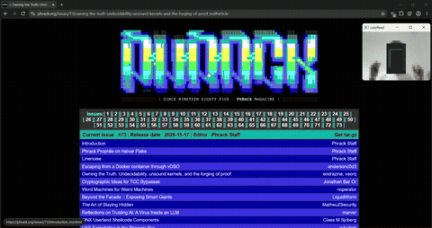

# LazyRead
 
LazyRead scrolls your screen up/down by moving your head (the **face position**, not your gaze), using your webcam and MediaPipe FaceLandmarker. The name comes from the laziness of scrolling long text by hand. Show an open hand to the camera to force a re-calibration.

> **Background:** LazyRead is a fork of the original [AutoScroller](https://github.com/DissanayakeLYB/AutoScroller) demo. Despite the old "eye tracking" name, the real control signal is the face position. See [Naming](#naming) below.

## Demo

[](demonstration.mp4)

*Recorded with privacy mode on: the face and room are hidden. Click the GIF to open the full video (`demonstration.mp4`).*

## What it does
1. Opens your webcam and detects your face.
2. For the first 2 seconds it **calibrates**: it locks the neutral face position and the area (bounding box) where your face currently is.
3. After that, if your **face** moves up or down past a small threshold, it scrolls the active window accordingly. Moving only your eyes does not scroll, because the face box barely moves without the head.
4. If your face leaves the tolerance container (a real sideways shift, or leaning in/out), it finds it again and **re-calibrates automatically** (about 1 second), so the old reference cannot cause false scrolling.
5. You can also force a re-calibration by showing an **open hand with all five fingers extended** to the camera. Any other hand pose (fist, pointing, victory, thumbs-up, hand seen edge-on) is ignored.
6. Scrolling only happens while your **eyes are on the screen**: look away or close your eyes and LazyRead keeps tracking the face but does not scroll. When you look back it resumes from 1x.
7. The preview has a **privacy mode** (on by default): the detected face is covered by a dark gray box and the rest of the frame is pixelated, while the tracking boxes and labels stay sharp. It is designed for sharing demos without showing your face or room.
8. Press **`r`** any time to recalibrate, **`k`** to pause/resume, **`p`** to toggle privacy, **`q`** to quit.

## Naming
The original AutoScroller project started as an eye-tracking demo, but its implementation averaged the pixel position of a few **eye-contour landmarks** as the scroll signal. Those landmarks are attached to the head: when you raise or lower your face they all move together, while a change of gaze moves them only slightly (the iris/pupil was not tracked). The real control signal was therefore the **face position**, not where you are looking.

LazyRead is named after the laziness of scrolling long text by hand. It is a fork of that original demo. The scroll signal comes from the **face-box centre directly**; the eye landmarks are only used to draw a debug overlay, and the eyes-on-screen gate uses the face **blendshapes**.

## Requirements
- Python 3.9+ (tested on 3.13)
- MediaPipe **1.x** (the old `mp.solutions` API was removed)
- A working webcam
- Internet access on first run (to download the ~3.7 MB `face_landmarker.task` and the ~7.8 MB `hand_landmarker.task` models)

## Setup
```bash
pip install -r requirements.txt
```

On first run the script downloads the FaceLandmarker and HandLandmarker models to `models/`.
 
On Linux you may also need:
```bash
sudo apt-get install python3-tk python3-dev scrot
```
(needed by `pyautogui` for screen control on some distros)
 
## Run
```bash
python LazyRead.py
```
 
A window titled **LazyRead** will open showing your webcam feed with the face area drawn as a box.
The preview starts in **privacy mode**: the face is covered by a dark gray box and the background is pixelated. Press **`p`** to see the normal feed.
Hand landmarks are drawn too: **green dots** mean the open-hand gesture was recognised, **orange dots** mean the hand is doing something else and will not trigger a re-calibration.
To check and tune the eyes-on-screen gate, run `python gaze_test.py` (see below).
 
## Usage tips
- During calibration, keep your head still inside the **yellow box** and look straight at the screen. The baseline is the median of ~2 s of frames, so a blink or two does not spoil it.
- While tracking, the **gray box is the tolerance container**: small sideways shifts inside it are ignored. The thin yellow box is the calibrated face reference and the green box is where the face is now.
- Small, deliberate up/down **head** movements trigger scrolling; moving only your eyes (gaze) has little effect. Normal blinking won't trigger anything.
- **Eyes on screen:** if you look away or close your eyes, LazyRead shows `Look at the screen` and stops scrolling while keeping the face tracked. Looking back resumes from 1x.
- **Hand re-calibration:** raise your hand with all five fingers extended and the palm (or back of the hand) facing the camera, like a "stop" gesture, and hold it for a moment. Green landmark dots confirm the pose; orange dots mean it was not recognised.
- **Privacy mode (`p`):** the face is replaced by a solid gray box and everything else is pixelated. Detection still runs on the untouched frame, so scrolling is unaffected. Use it when recording a demo.
- **Pause (`k`):** releases the webcam (LED off, models idle) and reopens/recalibrates when you press `k` again.
- **Ctrl pauses scrolling:** while Ctrl is held, no wheel events are sent, so browser/PDF zoom shortcuts (Ctrl+wheel) do not fire. Release Ctrl to resume. Works on Windows, macOS and Unix/X11; on Wayland the global key state may not be readable, in which case the guard is simply inactive.
- If scrolling feels too sensitive or too sluggish, tweak these constants near the top of `LazyRead.py`:
  - `SCROLL_UP_THRESHOLD` / `SCROLL_DOWN_THRESHOLD` — how far your **face** must move (in pixels, measured from the face box) to trigger a scroll
  - `SCROLL_AMOUNT` — base scroll step; `SCROLL_RAMP_STEP_MS` / `SCROLL_MAX_EXPONENT` control the acceleration (up to 32x with the default exponent)
  - `COOLDOWN` — minimum time between scroll actions
  - `CALIBRATION_TIME` / `RECALIBRATION_TIME` — initial and automatic re-calibration duration
  - `FACE_CONTAINER_X_PX` — lateral tolerance in pixels (default 80): sideways movement inside ±this value is ignored, so normal head jitter does not cost a re-calibration; leaving it for a few frames re-locks the reference
  - `FACE_CONTAINER_Y_PX` — vertical tolerance in pixels (default 140), deliberately wider than the scroll range so a normal up/down gesture does not interrupt tracking
  - `FACE_MOVE_FRAMES` / `FACE_LOST_FRAMES` — consecutive frames required before declaring the face outside the container or lost (higher = more tolerant)
  - `HAND_FINGER_MIN_ANGLE` — joint angle (degrees) above which a finger counts as extended; lower it if your thumb is not recognised
  - `HAND_PALM_MIN_FACING` — how front-facing the palm must be (0–1, higher = stricter)
  - `HAND_CONFIRM_CHECKS` / `HAND_RELEASE_CHECKS` — consecutive checks needed to trigger and to re-arm the gesture
  - `HAND_CHECK_EVERY` — runs the hand model every N frames (default 4; 1 = every frame, higher = lighter CPU)
  - `ENABLE_GAZE_GATE` — enable the eyes-on-screen gate
  - `GAZE_LATERAL_MAX` / `GAZE_DOWN_MAX` / `GAZE_UP_MAX` — sideways tolerance, looking-down threshold (blocks) and looking-up allowance
  - `GAZE_BLINK_MAX` / `GAZE_BLINK_HOLD_FRAMES` — closed-eye threshold and how long a blink may last before pausing
  - `GAZE_ON_FRAMES` / `GAZE_OFF_FRAMES` / `GAZE_SMOOTHING` — hysteresis and smoothing of the gaze decision
  - `ENABLE_HEAD_GATE` / `HEAD_PITCH_DOWN_MAX_DEG` / `HEAD_PITCH_UP_MAX_DEG` — downward head tilt blocks; upward tilt is allowed for scroll-up
  - `HEAD_UP_FREE_DEG` — when the head is clearly up, the eye up/down gate is ignored (the scroll-up pose raises `eyeLookDown`)
  - `GAZE_DEBUG` — draw raw/filtered gaze metrics and head pitch on the preview (also printed once per second)
  - `PRIVACY_MODE` — start with the privacy preview on/off (toggle with `p`)
  - `CAPTURE_WIDTH` / `CAPTURE_HEIGHT` / `TARGET_FPS` — capture settings (default 480×360 @ 15 fps)
  - `IDLE_AFTER_SECONDS` / `IDLE_FPS` — idle mode when no face is visible
  - `PRIVACY_BOX_COLOR`, `PRIVACY_FACE_PADDING`, `PRIVACY_PIXEL_BLOCK` — face-cover color, extra margin (30%) and pixelation block size (16 px)
- Move your mouse to a screen corner at any time to trigger pyautogui's fail-safe and stop automated input immediately.

## What changed from AutoScroller
- Rebranded as **LazyRead**: the entry point is now `LazyRead.py` and the preview window is titled `LazyRead`.
- Closing the preview window with the X button now exits cleanly instead of letting `imshow` recreate it.
- Scrolling pauses while Ctrl is held, so Ctrl+wheel does not zoom the page being scrolled.
- Reduced CPU/battery use: 480×360 @ 15 fps capture, hand model every 4 frames and only while tracking, 5 fps idle mode with no face, and the camera is released while paused.
- Added an eyes-on-screen gate based on face blendshapes: scrolling pauses when you look away or close your eyes, without losing the face tracking.
- Added a head-pitch gate: a clear downward tilt away from the calibrated head pose pauses scrolling immediately, while the upward tilt used for scroll-up is allowed.
- Added `gaze_test.py` to inspect the gaze metrics and suggest thresholds.
- Added a privacy preview (dark face box + pixelated background), toggled with `p`, for demos that must not show the user or the room.
- Added a lateral tolerance container: small sideways head movements are ignored, while a real lateral shift re-locks the vertical baseline automatically.
- Removed dead code (`locked_left_eye` / `locked_right_eye` were computed but never used).
- Fixed structure: previously the capture loop ran at import time regardless of `__main__`, and cleanup only ran inside the `__main__` guard — this could leak the camera handle. Now everything is wrapped in `main()` and released in a `finally` block, so the webcam is released even if an error occurs.
- Added a webcam-open check (`cap.isOpened()`), since the original assumed the camera always opens successfully.
- Added a scroll **cooldown** so one sustained head movement doesn't fire dozens of scroll events per second.
- Added a mirror flip (`cv2.flip`) so the feed matches natural mirror expectations.
- Added a recalibration key (`r`) and an on-screen "no face detected" message.
- Replaced the manual `boundingRect` eye-centroid math with the face-box centre (fewer moving parts, same vertical signal).
- Properly closes the MediaPipe FaceLandmarker instance on exit.
- Documented and fixed a long-standing misnomer: the script tracks the **face position**, not the eyes. The averaged eye landmarks shifted 1:1 with the head, while a pure gaze change barely moved them, so raising/lowering the face is the real input. The scroll signal now comes from the face-box centre, and the eye landmarks are no longer read.

## Origin and license
LazyRead is a fork of [DissanayakeLYB/AutoScroller](https://github.com/DissanayakeLYB/AutoScroller), released under the MIT License. The original copyright notice is kept in [LICENSE](LICENSE).

## Face-area calibration
- During calibration the script records the face's bounding box (from 36 face-oval landmarks, not all 478, so it stays cheap). Its centre and size are averaged with a **median**, which is why 2 s are enough: blinks and single bad frames are ignored.
- The vertical scroll signal is the **face-box centre** relative to that baseline: head translation moves it directly, while moving just your eyes does not. The eye landmarks are no longer read.
- While tracking, the face-box centre is compared with the baseline every frame. A **tolerance container** of ±`FACE_CONTAINER_X_PX` × ±`FACE_CONTAINER_Y_PX` reference pixels (tuned at 640×480 and scaled automatically to the capture size) around the baseline is drawn in gray: small sideways shifts inside it are ignored, but leaving it for `FACE_MOVE_FRAMES` consecutive frames discards the baseline and re-locks in ~1 s, so the next vertical gesture starts from a fresh position. Box size changes beyond `FACE_SIZE_TOLERANCE` also trigger a re-lock (leaning in/out).
- The lateral tolerance is the point of the container: the head never stays perfectly still, so lateral jitter should not cost a re-calibration. When the drift is real, the re-lock is actually useful: it re-centres the vertical reference before the next up/down movement.
- If the face is not detected for `FACE_LOST_FRAMES` frames, the old baseline is discarded too; when the face comes back, calibration restarts from the new position.
- MediaPipe's VIDEO mode already re-detects the face when tracking is lost, so "finding it again" needs no extra inference pass.

## Hand-gesture recalibration
- The HandLandmarker model returns 21 landmarks. The gesture counts as "open hand toward the camera" only when **all five fingers are extended** (angle at the MCP/IP joint ≥ `HAND_FINGER_MIN_ANGLE`, 145°) **and** the palm plane is roughly parallel to the image plane (`|normal.z| / |normal| ≥ HAND_PALM_MIN_FACING`, 0.6). A minimum model confidence of 0.7 rejects uncertain detections.
- The model is configured for **up to two hands** (`num_hands=2`, detection confidence 0.4), so the gesture works with either hand and the open right hand is still found when the other hand is also in frame. The trigger fires if **any** detected hand matches the pose.
- Palm and back of the hand are treated the same: both are a flat "stop" hand shown to the camera.
- Fist, pointing, victory, thumbs-up and hands seen edge-on fail the angle or palm-plane test, so ordinary hand movements do not reset the calibration.
- The trigger is **edge-based**: it fires after `HAND_CONFIRM_CHECKS` consecutive positive checks and stays latched until the hand disappears for `HAND_RELEASE_CHECKS` checks. This is why holding the open hand does not cause an endless recalibration loop.
- A gesture shown during the initial calibration is ignored (the calibration is already running); lower the hand and show it again afterwards.
- The hand model is the expensive one (~12 ms/frame with one hand, ~23 ms with two, vs ~3 ms for the face), so it runs every `HAND_CHECK_EVERY` frames (default 4) and **only while a face is tracked and calibration is complete**. During calibration, recalibration or with no face it is not called at all. With the face model also running, the whole loop costs ~12–13 ms/frame on CPU.

## Eyes on screen (gaze gate)
- Scrolling only makes sense while you are looking at the screen, so LazyRead reads the `eyeLookIn/Out/Up/Down` and `eyeBlink` **blendshapes** from the face model. `lateral` is the sum of the in/out scores, `up`/`down` are the separate eyeLookUp and eyeLookDown scores (averaged over both eyes), and `blink` is the average eye-blink score. Looking **down** is blocked; looking **up** is allowed because it is part of the scroll-up gesture.
- When the head is clearly up (`HEAD_UP_FREE_DEG`), the eye up/down gate is ignored: `eyeLookDown` often rises as a pose artefact during a head-up scroll-up, even though you are not looking down. The lateral gate still applies.
- The decision is smoothed with an EMA (`GAZE_SMOOTHING`) and has hysteresis: it needs `GAZE_ON_FRAMES` consecutive on-screen frames to start and `GAZE_OFF_FRAMES` consecutive off-screen frames to stop. A short blink is held (`GAZE_BLINK_HOLD_FRAMES`); a long closure pauses scrolling.
- A **raw** lateral/down/up value above its threshold blocks the current frame immediately, without waiting for the EMA, so the first frame of a clear look down/sideways cannot trigger a scroll.
- When the gate is closed the face is still tracked and the calibration is kept; only scrolling pauses (and the speed ramp resets). The preview shows `Look at the screen`.
- The gate fails open if the model returns no blendshapes, so an older model does not block scrolling.
- Looking down at the keyboard or phone often tilts the head while the eye blendshapes stay near neutral. LazyRead also reads the facial transformation matrix and learns the baseline **head pitch** during the 2 s calibration. A **downward** deviation larger than `HEAD_PITCH_DOWN_MAX_DEG` pauses scrolling immediately; an **upward** deviation is allowed up to `HEAD_PITCH_UP_MAX_DEG` so the scroll-up gesture is not blocked. Set `ENABLE_HEAD_GATE = False` to disable this.
- The pitch baseline is kept across automatic face-position re-calibrations (the `base` does not reset); it is re-learned only with `r`, after a pause or after a face loss.
- `ENABLE_GAZE_GATE = False` disables the gate (and stops requesting blendshapes), reverting to face-only behaviour.
- The gaze gate still works in privacy mode: it uses landmarks/blendshapes, not the displayed pixels.

### Testing and tuning the gaze gate
Run `python gaze_test.py`:
- it shows live `lateral`, `up`, `down` and `blink` values, the thresholds and the `ON SCREEN` / `AWAY` decision;
- eye contours and iris points are drawn on the preview;
- press **`1`** and look at the screen for 3 s;
- press **`2`** and look away (left/right/down) for 3 s;
- press **`3`** and close your eyes for 2 s;
- the script prints min/max/mean for each phase and suggests `GAZE_LATERAL_MAX`, `GAZE_DOWN_MAX` and `GAZE_BLINK_MAX`. `GAZE_UP_MAX` is left high because looking up is the scroll-up direction.

The lateral suggestion is only a starting point: the scroll-up pose can raise `lateral` (0.45–0.63 in a measured session), so keep `GAZE_LATERAL_MAX` above that value (e.g. 0.65) even if the midpoint between on-screen and sideways is lower.

Leave a real margin: never set a threshold at the on-screen maximum, or normal jitter and eyelid movement will look like "away". Example from a measured session: on-screen `down` ~0.15 and looking down ~0.42 → use ~0.30; on-screen `blink` ~0.06 and closed ~0.58 → use ~0.35. With `GAZE_DEBUG = True` the app shows raw and filtered `L`, `U`, `D`, `B`, the head `pitch`/`base`, `hu`/`hd` and `on` on the preview, and prints the same line to the console once per second.

Tune the head gate in the app: look at the screen and note `pitch`/`base`; look down at the keyboard and note the positive delta; look up as for a scroll-up and note the negative delta. Set `HEAD_PITCH_DOWN_MAX_DEG` between the screen and down values. `HEAD_UP_FREE_DEG` is the head-up angle beyond which the eye up/down gate is ignored; `HEAD_PITCH_UP_MAX_DEG` only blocks an extreme upward tilt.

Glasses reflections, strong side light or unusual eye shapes can shift the scores; tune the thresholds with the test. The blendshape submodel adds a small amount of CPU; disable `ENABLE_GAZE_GATE` if you prefer the old behaviour.

Typical values from a measured session: on screen `lateral ≈ 0.24–0.33`, `down ≈ 0.13–0.22`, `blink ≈ 0.04–0.13`; during a head-up scroll-up `lateral ≈ 0.45–0.63` with `down ≈ 0.4–0.7` (pose artefact, ignored); looking sideways `lateral ≈ 0.72+`; eyes closed `blink ≈ 0.58`. Use them as a sanity check, not as universal values.

Looking up must stay allowed: the head-up pose ignores the eye up/down gate (the `eyeLookDown` score often rises as a pose artefact), while the lateral gate still applies.

## Privacy mode
- Detection, calibration and scrolling always use the **original frame**. Privacy mode only builds the preview: the frame is pixelated (block size `PRIVACY_PIXEL_BLOCK`), then the detected face is replaced by a solid `PRIVACY_BOX_COLOR` rectangle expanded by `PRIVACY_FACE_PADDING` (30%).
- Boxes, labels, the calibration bar and the hand dots are drawn **after** the privacy step, so they stay sharp and the demo remains readable.
- If no face is detected, the whole preview stays pixelated; nothing identifiable is shown.
- Press `p` to toggle it at runtime; `PRIVACY_MODE` sets the initial state (default `True`).
- The hand image is pixelated too, but its landmark dots remain visible. To hide tattoos or rings more aggressively, raise `PRIVACY_PIXEL_BLOCK` (e.g. 24).

### Recording a demo
- Keep privacy mode on and record the LazyRead window next to the page you are scrolling.
- Use a clean browser profile (no personal tabs, bookmarks or notifications) and a plain background.
- The README demo is `docs/demo.gif`, a compressed full-length preview of `demonstration.mp4`; keep the MP4 linked for the full quality.
- A short GIF under ~10 MB works well for the README; strip metadata with `ffmpeg -map_metadata -1`.

## Battery and performance
- The webcam is opened at 480×360 and asked for 15 fps (`CAPTURE_WIDTH`, `CAPTURE_HEIGHT`, `TARGET_FPS`). If the camera offers a different size, the actual frame size is used and the scroll/container thresholds stay in **640×480 reference pixels** (`REFERENCE_WIDTH` / `REFERENCE_HEIGHT`), so the feel does not change.
- A loop limiter caps processing at 15 fps even if the camera ignores the request. The sensor may still run faster, but CPU work is bounded.
- The hand model runs every `HAND_CHECK_EVERY` frames (default 4) and only while a face is tracked and calibration is complete.
- The gaze gate requests the face blendshapes and, for the head gate, the facial transformation matrix (a small extra cost); set `ENABLE_GAZE_GATE = False` and `ENABLE_HEAD_GATE = False` to remove them and return to face-only behaviour.
- After `IDLE_AFTER_SECONDS` (default 3 s) without a face the loop drops to `IDLE_FPS` (default 5) until a face returns.
- Pausing with `k` releases the camera (LED off) and idles both models; resuming reopens the camera and recalibrates.
- `pyautogui.PAUSE = 0` removes the 0.1 s sleep after each scroll; `COOLDOWN` still limits scroll events.
- Net effect: roughly half the CPU in normal use and near-zero camera/model work while paused.

## Known limitations
- This is **face-position tracking, not gaze tracking** for the scroll signal: nodding, leaning or shifting your posture scrolls the page, while moving your eyes alone has little effect. The eyes-on-screen gate only decides *whether* scrolling is allowed; it does not steer the scroll. Automatic re-calibration resets the reference after large movements.
- The gaze gate is an estimate from face blendshapes: glasses reflections, strong side light or unusual eye shapes may need threshold tuning with `gaze_test.py`.
- The head gate treats a strong **downward** nod as "looking away"; upward tilt is allowed for scroll-up. If head-down scroll gestures are blocked, raise `HEAD_PITCH_DOWN_MAX_DEG`; if looking up for scroll-up is blocked, raise `HEAD_PITCH_UP_MAX_DEG` (or set `ENABLE_HEAD_GATE = False`).
- Works with one face only (`max_num_faces=1`).
- Lighting conditions affect landmark detection accuracy.